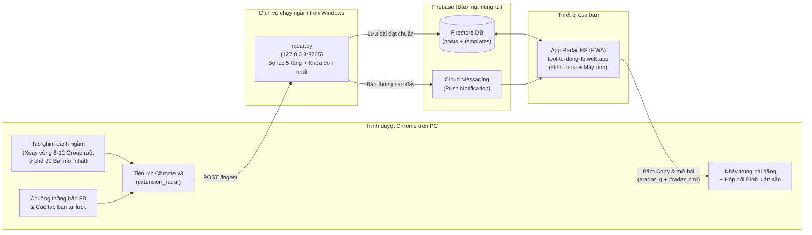

# 📡 Radar Tìm Học Sinh (`v3.0`) — Nguyên Lý & Hướng Dẫn Tối Ưu

Hệ thống tự động phát hiện các bài đăng **tìm gia sư Toán · Lý · Hóa (Lớp 10, 11, 12 — Online)** mới nhất trong các Group Facebook, lọc sạch bài rác/trung tâm/dạy tại nhà, gắn sẵn mẫu bình luận đúng môn và bắn thông báo tức thì về **App riêng trên Điện thoại + Máy tính** (`https://tool-tu-dong-fb.web.app`).

---

## 1. Nguyên lý hoạt động tổng thể

### 1.1. Sơ đồ kiến trúc (`v3.0`)



### 1.2. Tại sao kiến trúc này vừa bắt đủ bài, vừa an toàn 100% cho nick Facebook chính?
1. **Không bỏ sót bài như Chuông hay Gmail:** Facebook hiện đã ngưng gửi email từng bài Group và bóp thông báo trong Chuông (chỉ báo ~10–20% bài). Thay vì chờ Facebook báo, tiện ích dùng **1 tab ghim nhỏ gọn** mở trực tiếp từng Group bạn đã tích chọn với tham số `?sorting_setting=CHRONOLOGICAL` (**ép Facebook xếp bài vừa đăng lên đầu trang**), tự động bấm mở mọi nút **"Xem thêm"** để lộ toàn bộ nội dung cuối bài (tránh sót dòng *Địa chỉ* bị ẩn bên dưới), và **cuộn sâu liên tục quét sạch mọi bài đăng trong vòng 2 ngày gần nhất** rồi mới dừng.
2. **Đọc được mọi định dạng bài đăng trên Facebook hiện đại:**
   - **Bài văn bản thường** (`[data-ad-preview="message"]`).
   - **Bài ngắn chữ to đậm 1 dòng** (dưới 85 ký tự, ví dụ: *"tìm gia sư dạy vật lí ạ"*).
   - **Bài chữ gõ trên nền màu / ảnh nền minh họa** (`div[dir="auto"]` hiển thị thực + `aria-label`).
   - Tự động loại bỏ các thẻ chữ ẩn chống quét của Facebook (`0px` / `aria-hidden`) và cắt bỏ toàn bộ phần **Bình luận bên dưới bài** để bình luận của gia sư khác không làm nhiễu bộ lọc.
3. **An toàn tuyệt đối cho tài khoản Facebook chính chủ:**
   - **Không** trích xuất cookie hay mật khẩu Facebook ra ngoài.
   - **Không** gọi ngầm API nội bộ của Facebook, **không** tự động click nút, **không** tự động gửi bình luận hay thả like ảo.
   - Bạn luôn là người nhìn bài 2 giây, nhấn `Ctrl + V` và `Enter` — vừa không bao giờ dính checkpoint/ẩn bình luận (shadowban), vừa không bình luận nhầm ngữ cảnh.

---

## 2. Nguyên lý Bộ lọc 5 tầng trong `radar.py`

Mỗi bài viết đi qua 5 màng lọc tuần tự từ nhanh đến sâu:

| Tầng | Kiểm tra | Quy tắc xử lý |
| :--- | :--- | :--- |
| **1. Địa chỉ trực tiếp (Offline)** | Nhãn `Địa chỉ:`, `Đ/c:`, `Khu vực:`, `số nhà`, `ngõ`, `ngách`, `hẻm`, `chung cư`, `KĐT`, `bến xe`, `phường ...`, `quận ...`, hoặc tên các quận tại HN & TP.HCM (*Cầu Giấy, Đống Đa, Thanh Xuân, Lạc Long Quân, Bình Thạnh...*) | **Loại ngay** (vì đây là lớp học trực tiếp tại nhà, kể cả khi người đăng không ghi chữ *offline*). Đã xử lý phân biệt dấu để không nhầm với *"phương trình"*, *"quãng đường"*, *"quan trọng"*. |
| **2. Từ khóa loại trừ cứng** | `offline`, `học off`, `trực tiếp`, `tại nhà`, `ở nhà`, `đến nhà`, `kèm 1:1`, `1-1`, `1 kèm 1`, `tiểu học`, `cấp 1`, `cấp 2`, `THCS`, `mầm non` | **Loại ngay** theo đúng tiêu chí dạy của bạn. |
| **3. Chống bài gia sư khác tự PR** | `tìm lớp gia sư`, `tìm lớp dạy`, `tìm thêm học sinh / học viên`, `kính chào các bậc phụ huynh`, `con/em đang...`, `phụ huynh có nhu cầu`, `em/mình là sinh viên...`, `theo CV / CV dưới đây`, `đối tượng nhận dạy`, `nhận dạy / nhận kèm / nhận lớp`, `mở lớp / gom nhóm / chiêu sinh` | **Loại ngay** các bài sinh viên/giáo viên/trung tâm đăng hồ sơ đi xin lớp (nhưng vẫn **nhận** nếu phụ huynh viết *"cần tìm gia sư Toán 11, yêu cầu sinh viên năm 2, gửi CV qua zalo"*). |
| **4. Nhu cầu & Môn học** | Cụm nhu cầu linh hoạt (*tìm/cần/kiếm/kím/tuyển/hỏi ... gia sư/gs/gv/thầy/cô/người dạy/sv kèm*, *có ai dạy...*, *pass lớp*) **VÀ** có môn **Toán** (*Đại số, Hình học, Giải tích*), **Lý** (*Vật lý, Vật lí*), **Hóa** (*Hóa học*), hoặc **Khối A / A00 / A01** | **Phải thỏa cả hai.** Tự xóa trước các từ đồng âm dễ nhầm (*toàn bộ, an toàn, Thanh Hóa, văn hóa, quản lý, hợp lý, tâm lý...*). |
| **5. Khối lớp / Năm sinh** | Lớp `10, 11, 12` (`lớp 10`, `khối 11`, `k12`, `Toán 12`...) hoặc năm sinh THPT (`2k11` → 10, `2k10` → 11, `2k9` / `2k8` → 12) | - Ghi `10 / 11 / 12` → **NHẬN**<br>- **Không ghi lớp** (vd: *"tìm gia sư dạy vật lí ạ"*) → **VẪN NHẬN**<br>- Ghi lớp `1–9` hoặc `2k12` trở xuống → **LOẠI**<br>- Chống nhầm số buổi/học phí (*"Toán 2 buổi/tuần"*, *"Lý 1 tuần 3 buổi"*, *"100k"*) thành số lớp. |

Khi bài **ĐẠT**, hệ thống tự động chọn đúng mẫu bình luận theo môn ưu tiên (**Toán → Mẫu Toán**, **Lý → Mẫu Lý**, **Hóa → Mẫu Hóa**) lưu vào bài đăng trước khi bắn thông báo.

---

## 3. Cấu trúc thư mục dự án

| Đường dẫn | Chức năng |
| :--- | :--- |
| `radar.py` | Trái tim xử lý ngầm: mở cổng `127.0.0.1:8765`, lọc bài 5 tầng, chọn mẫu theo môn, chống chạy trùng (`radar.lock`), ghi nhật ký (`radar.log`). |
| `firebase_app.py` | Kết nối Firestore & gửi thông báo đẩy FCM (viết bằng Python chuẩn, không cần `pip install`). |
| `deploy.py` | Đẩy giao diện Web App & quy tắc bảo mật `firestore.rules` lên mạng trong ~3 giây. |
| `chay_ngam_radar.vbs` | Nhấp đúp để chạy `radar.py` ẩn hoàn toàn dưới nền Windows (không hiện cửa sổ đen). |
| `chay_radar.bat` | Nhấp đúp nếu muốn mở cửa sổ dòng lệnh xem trực tiếp từng bài đang quét. |
| `config.json` | Chứa cấu hình cá nhân, từ khóa lọc, 3 mẫu bình luận Toán/Lý/Hóa (được `.gitignore` bảo vệ). |
| `extension_radar/` | Tiện ích Chrome `v3.0`: `background.js` (xoay vòng tab), `content.js` (đọc bài & hộp bình luận nổi), `popup.html` (điều khiển & xem log), `groups.html` (bảng tích chọn nhóm `☑️`). |
| `app/public/` | Mã nguồn Web App PWA (`https://tool-tu-dong-fb.web.app`) cài trên Điện thoại & Máy tính. |

---

## 4. Hướng dẫn vận hành chuẩn từng bước

### Bước 1: Đảm bảo `radar.py` đang chạy ngầm trên máy tính
- Nhìn biểu tượng tiện ích góc trên bên phải Chrome:
  - Hiện chữ **`ON` màu xanh lá** → `radar.py` đang chạy tốt.
  - Hiện chữ **`OFF` màu đỏ** → mở thư mục `01_Scripts_Code\radar_tim_hoc_sinh`, nhấp đúp vào **`chay_ngam_radar.vbs`**.
- **Mẹo tự chạy mỗi khi bật máy Windows (làm 1 lần):**
  Nhấn `Win + R` → gõ `shell:startup` → `Enter` → nhấn chuột phải tạo Shortcut trỏ tới file `chay_ngam_radar.vbs` (hoặc copy thẳng file `chay_ngam_radar.vbs` vào thư mục Startup đó). Từ sau cứ bật máy tính lên là Radar tự chạy ngầm!

### Bước 2: Tích chọn danh sách Group "mỏ vàng" (`☑️`)
1. Bấm icon **`ON`** góc trên bên phải Chrome → bấm **`☑️ Tích chọn các Nhóm để canh`**.
2. Bấm **`🔍 Mở danh sách Nhóm trên FB để tự quét tên nhóm`** → cuộn trang Facebook vừa mở xuống vài lượt để tiện ích thu thập hết tên các nhóm bạn đã tham gia → quay lại tab tích chọn.
3. Tích **`☑️`** vào các nhóm chất lượng nhất (tự động lưu ngay lập tức).
4. Trong Popup icon `ON`, chọn **`🔄 Chế độ 1: Xoay vòng Group`** (`60 giây`) → bấm **`⏭ Chuyển nhóm ngay`** 1 lần để khởi tạo tab ghim canh tự động ở góc trái trình duyệt.

### Bước 3: Thao tác chốt học sinh trong 3 giây khi có thông báo
- **Khi đang ngồi máy tính:**
  1. Thấy thông báo nổ → bấm vào thông báo (hoặc mở tab `Radar HS`) → bấm nút xanh **`📋 Copy & mở bài`**.
  2. Trình duyệt tự mở Facebook, **tự cuộn tới đúng bài đăng** (đóng khung xanh dương `🎯 BÀI ĐĂNG BẠN VỪA MỞ TỪ RADAR HS`), đồng thời hiện **hộp nổi Bình luận soạn sẵn** ở góc dưới phải (và đã chép sẵn vào Clipboard).
  3. Bạn click vào ô *"Viết bình luận..."* của bài viết → nhấn **`Ctrl + V`** → **`Enter`**.
  4. Quay lại `Radar HS` bấm **`✅ Đã bình luận`** để chuyển bài sang lịch sử đã xử lý.
- **Khi đang cầm điện thoại ở ngoài:**
  1. Điện thoại rung thông báo từ App `Radar HS` → bấm vào thông báo.
  2. Bấm **`📋 Copy & mở bài`** → App tự copy mẫu bình luận đúng môn và chuyển sang ứng dụng/trình duyệt Facebook mở bài đó → bạn nhấn giữ ô bình luận chọn **Dán (Paste)** → **Gửi**.

---

## 5. Bí quyết tối ưu hóa để đạt hiệu quả cao nhất

### 5.1. Cách chọn "Group ngon" và công thức tính tốc độ xoay vòng
- **Số lượng nhóm tối ưu: từ `6` đến `10` nhóm.**
  - Với chu kỳ **60 giây/nhóm**, nếu tích **8 nhóm** thì cứ **8 phút** Radar lại quét mới toàn bộ 8 nhóm một vòng.
  - Một bài tìm gia sư vừa đăng được 1–8 phút thường mới chỉ có 0–3 bình luận → bạn nhảy vào bình luận lúc này tỉ lệ phụ huynh/học sinh đọc và nhắn Zalo cao gấp nhiều lần so với lúc bài đã có 40–50 bình luận!
  - Nếu tích quá nhiều nhóm loãng (30–40 nhóm), vòng lặp sẽ kéo dài 30–40 phút mới quay lại nhóm chính, làm chậm tốc độ tiếp cận.
- **Tiêu chí nhận diện Group chất lượng nên tích `☑️`:**
  - Cho phép **Người tham gia ẩn danh** đăng bài (phụ huynh và học sinh cấp 3 rất thích đăng ẩn danh tìm gia sư).
  - Vào xem chế độ *Bài mới nhất* thấy cứ 15–30 phút lại có bài hỏi tìm người dạy thật, thay vì 100% bài của một trung tâm môi giới spam danh sách mã lớp thu phí.

### 5.2. Chống Chrome tự "ngủ đông" tab canh nền (Rất quan trọng!)
Chrome có tính năng *Trình tiết kiệm bộ nhớ (Memory Saver)* có thể làm đóng băng các tab nền sau một lúc không chạm tới. Bạn tắt ngủ đông riêng cho Facebook trong 10 giây như sau:
1. Mở tab mới trên Chrome, dán địa chỉ: **`chrome://settings/performance`** rồi nhấn `Enter`.
2. Ở mục **Luôn giữ cho các trang web này hoạt động** *(Always keep these sites active)* → bấm **Thêm (Add)**.
3. Nhập **`facebook.com`** → bấm **Thêm**.
4. Khi làm việc trên máy, cứ để cửa sổ Chrome mở bình thường dưới nền (đừng bấm tắt hẳn Chrome).

### 5.3. Mẹo bình luận để không bị Facebook quét Spam khi đi comment nhiều bài
Nếu trong 1 tiếng bạn dán y hệt 100% một đoạn văn bản có kèm SĐT Zalo vào 10–15 nhóm khác nhau, bộ lọc chống spam tự động của Facebook có thể tạm ẩn bình luận của bạn.
- **Cách tối ưu cực dễ ngay trên Hộp nổi của Radar:** Trước khi bấm Copy (hoặc sau khi `Ctrl + V` vào ô bình luận Facebook), bạn **thêm 1 câu ngắn 3–5 chữ ở dòng đầu khớp đúng bài đó**, ví dụ:
  - Bài hỏi *Lý 12 mất gốc*: gõ thêm `"Chào em, Lý 12 mất gốc cứ ib anh nhé!"` ở dòng đầu rồi xuống dòng dán mẫu.
  - Bài hỏi *Toán 11 mục tiêu 8+*: gõ thêm `"Anh nhận kèm Toán 11 lên 8+ nha em:"` ở dòng đầu.
- Chỉ tốn thêm **2 giây**, vừa làm nội dung mỗi bình luận khác nhau (Facebook đánh giá là người thật tương tác tự nhiên 100%), vừa khiến học sinh cảm thấy bạn đọc kỹ bài của họ chứ không phải rải tin công nghiệp!

---

## 6. Các lệnh quản trị & tinh chỉnh nhanh khi cần

Mở PowerShell tại thư mục `C:\Users\DELL\Documents\CODE\DU_AN\01_Scripts_Code\radar_tim_hoc_sinh`:

```powershell
# 1. Thử nghiệm xem 1 câu đăng bất kỳ sẽ ĐẠT hay BỎ QUA (và vì lý do gì):
python radar.py --test-text "Em 2k9 cần tìm gia sư Hóa ôn thi THPTQG ạ"

# 2. Gửi thử 1 thông báo đẩy tới Điện thoại & Máy tính để kiểm tra chuông:
python radar.py --test-notify

# 3. Xem 30 dòng nhật ký quét mới nhất khi đang chạy ngầm:
Get-Content -Encoding UTF8 radar.log -Tail 30

# 4. Nếu bạn sửa giao diện Web App trong thư mục app/public/, đẩy lại lên mạng trong 3 giây:
python deploy.py
```

- **Sửa nhanh 3 mẫu bình luận Toán / Lý / Hóa:** Mở trực tiếp `https://tool-tu-dong-fb.web.app` → cuộn xuống cuối trang mục **`📌 Mẫu bình luận nhanh`** → sửa nội dung → bấm **`💾 Lưu chỉnh sửa`** (đồng bộ tức thì trên cả điện thoại và máy tính), đồng thời cập nhật mục `"mau_theo_mon"` trong `config.json` để các bài mới đổ về tự nhận mẫu mới.
- **Thêm/bớt từ khóa lọc:** Chỉnh trực tiếp mảng `tu_loai_tru` hoặc `mon_hoc` trong `config.json` — `radar.py` tự động đọc lại `config.json` ở mỗi lượt nhận bài mà **không cần khởi động lại máy**.

---

## 7. Xử lý sự cố thường gặp (Troubleshooting)

| Hiện tượng | Nguyên nhân & Cách khắc phục |
| :--- | :--- |
| Icon tiện ích hiện **`OFF` màu đỏ** | Tiến trình `radar.py` chưa bật (ví dụ vừa khởi động lại máy). Vào thư mục nhấp đúp `chay_ngam_radar.vbs` (hoặc cài vào `shell:startup` theo Bước 1 mục 4). |
| Vừa sửa code tiện ích trong `extension_radar/` mà chưa thấy đổi | Mở `chrome://extensions` → bấm nút xoay tròn **🔄 (Tải lại)** ở thẻ *Radar Tìm Học Sinh v3*. |
| App trên máy tính có bài mới nhưng Điện thoại không rung | Mở App `Radar HS` từ màn hình chính điện thoại → kiểm tra nút góc trên phải đã hiện **`🔔 Đã bật`** màu xanh lá chưa (với iPhone cần iOS 16.4+ và mở từ icon ngoài Màn hình chính). |
| Muốn tạm dừng tự xoay vòng nhóm khi đang bận việc nặng | Bấm icon **`ON`** góc phải Chrome → đổi *Chế độ canh* sang **`🖐 Chế độ 2: Thủ công khi lướt`** (lúc nào rảnh đổi lại Chế độ 1). |
